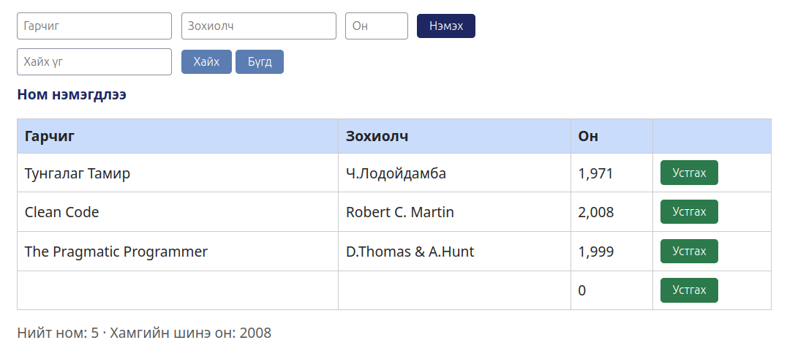

# BUG-01: Гурван талбар хоосон байхад номын жагсаалтад шинэ мөр нэмэгддэг

- **Орчин:** «Уншлагын жагсаалт» v2.0, Ubuntu Linux, session-д ашигласан браузер (яг хувилбарыг README-ийн орчны хэсгээс харна).
- **Session-д олдсон цаг:** 2026-10-16 23:26:29, UTC+08:00.
- **Олдсон аялал:** Couch Potato.

## Урьдчилсан нөхцөл

Өмнөх Node процессыг Ctrl+C-ээр зогсоож `node app.js`-ийг шинээр ажиллуулсан. Браузерын хуудсыг refresh хийсэн, анхны гурван номтой төлөвөөс эхэлнэ. Өөр тестийн нэмсэн ном, өөрчилсөн төлөвт найдахгүй.

## Дахин гаргах алхам

1. http://localhost:3000 хаягийг нээж, анхны гурван ном харагдаж байгааг шалгана.
2. Гарчиг, Зохиолч, Он талбаруудыг бүгдийг хоосон үлдээнэ.
3. Ном нэмэх товчийг нэг удаа дарна.
4. Жагсаалтад шинэ мөр нэмэгдсэн эсэх, мессежийг ажиглана.

## Хүлээгдэж буй үр дүн

Гарчиг, зохиолч, он бүгд заавал бөглөгдөх тул ном нэмэгдэхгүй, дутуу оролтын ойлгомжтой мессеж харагдана.

## Бодит үр дүн — session-ийн нотолгоо

Түүхий тэмдэглэл, screenshot-д гарчиг/зохиолч хоосон, он нь 0 гэж харагдах шинэ мөр болон «Ном нэмэгдлээ» мессеж байна.

## Ноцтой байдал

Major — заавал бөглөх талбарын шалгалтгүйгээс хүчин төгөлдөр бус ном жагсаалтад ордог.

## Нотолгоо

[Session report](../session-report.md)

