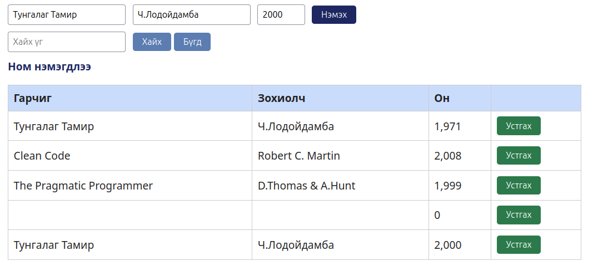

# BUG-02: Ижил гарчиг, зохиолчтой номыг дахин бүртгэдэг

- **Орчин:** «Уншлагын жагсаалт» v2.0, Ubuntu Linux, session-д ашигласан браузер (яг хувилбарыг README-ийн орчны хэсгээс харна).
- **Session-д олдсон цаг:** 2026-10-16 23:34:41, UTC+08:00.
- **Олдсон аялал:** Couch Potato.

## Урьдчилсан нөхцөл

Өмнөх Node процессыг Ctrl+C-ээр зогсоож `node app.js`-ийг шинээр ажиллуулсан. Браузерын хуудсыг refresh хийсэн, анхны гурван номтой төлөвөөс эхэлнэ. Өөр тестийн нэмсэн ном, өөрчилсөн төлөвт найдахгүй.

## Дахин гаргах алхам

1. Анхны гурван ном дотор «Тунгалаг Тамир», «Ч.Лодойдамба» байгаа эсэхийг шалгана.
2. Гарчигт Тунгалаг Тамир гэж оруулна.
3. Зохиолч талбарт анхны номын зохиолчийн бичлэгийг яг адил Ч.Лодойдамба гэж оруулна; нэмэлт зай оруулахгүй.
4. Он талбарт 2000 гэж оруулна.
5. Ном нэмэх товчийг нэг удаа дараад ижил гарчиг, зохиолчтой мөр нэмэгдсэн эсэхийг ажиглана.

## Хүлээгдэж буй үр дүн

Ижил гарчиг, зохиолчтой ном давхардуулахгүй. Он өөр байсан ч энэ дүрэм үйлчилнэ.

## Бодит үр дүн — session-ийн нотолгоо

Нотолгоонд анхны номын хажуугаар ижил гарчиг, зохиолчтой, 2000 онтой шинэ номын мөр нэмэгдсэн байна.

## Ноцтой байдал

Major — давхардал хориглох үндсэн дүрэм зөрчигдөж өгөгдлийн чанар алдагдана.

## Нотолгоо

[Session report](../session-report.md)
