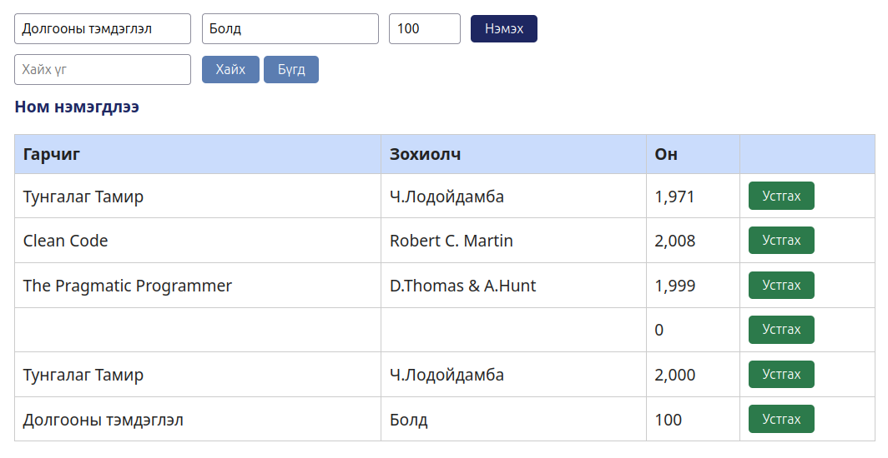

# BUG-03: Он=100 утгатай номыг зөвшөөрч бүртгэдэг

- **Орчин:** «Уншлагын жагсаалт» v2.0, Ubuntu Linux, session-д ашигласан браузер (яг хувилбарыг README-ийн орчны хэсгээс харна).
- **Session-д олдсон цаг:** 2026-10-16 23:40:41, UTC+08:00.
- **Олдсон аялал:** Couch Potato.

## Урьдчилсан нөхцөл

Өмнөх Node процессыг Ctrl+C-ээр зогсоож `node app.js`-ийг шинээр ажиллуулсан. Браузерын хуудсыг refresh хийсэн, анхны гурван номтой төлөвөөс эхэлнэ. Өөр тестийн нэмсэн ном, өөрчилсөн төлөвт найдахгүй.

## Дахин гаргах алхам

1. Гарчиг талбарт Долгооны тэмдэглэл гэж оруулна.
2. Зохиолч талбарт Болд гэж оруулна.
3. Он талбарт 100 гэж оруулна.
4. Ном нэмэх товчийг нэг удаа дараад жагсаалтыг ажиглана.

## Хүлээгдэж буй үр дүн

Он нь 1000–2100 хоорондох бүхэл тоо байх ёстой тул 100 утгатай ном нэмэгдэхгүй, ойлгомжтой алдааны мессеж харагдана.

## Бодит үр дүн — session-ийн нотолгоо

«Долгооны тэмдэглэл / Болд / 100» гэсэн номын мөр нэмэгдэж, «Ном нэмэгдлээ» мессеж харагдсан.

## Ноцтой байдал

Major — оны зөвшөөрөгдөх хүрээний validation зөрчигдөнө.

## Нотолгоо

[Session report](../session-report.md)