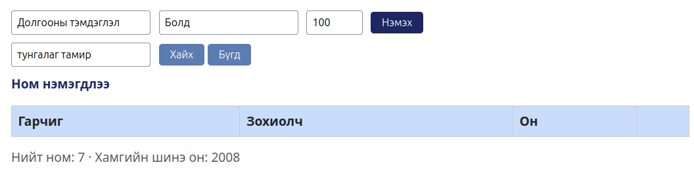

# BUG-04: Хайлт жижиг үсгээр бичсэн байгаа номын гарчгийг олдоггүй

- **Орчин:** «Уншлагын жагсаалт» v2.0, Ubuntu Linux, session-д ашигласан браузер (яг хувилбарыг README-ийн орчны хэсгээс харна).
- **Session-д олдсон цаг:** 2026-10-16 23:51:28, UTC+08:00.
- **Олдсон аялал:** Couch Potato.

## Урьдчилсан нөхцөл

Өмнөх Node процессыг Ctrl+C-ээр зогсоож `node app.js`-ийг шинээр ажиллуулсан. Браузерын хуудсыг refresh хийсэн, анхны гурван номтой төлөвөөс эхэлнэ. Өөр тестийн нэмсэн ном, өөрчилсөн төлөвт найдахгүй.

## Дахин гаргах алхам

1. Анхны жагсаалтад «Тунгалаг Тамир» ном байгааг шалгана.
2. Хайх үг талбарт тунгалаг тамир гэж бүх үсгийг жижиг хэлбэрээр оруулна.
3. Хайх товчийг дарна.
4. Хайлтын үр дүнд тухайн номын мөр байгаа эсэхийг ажиглана.

## Хүлээгдэж буй үр дүн

Хайлт том/жижиг үсэг ялгахгүй тул «Тунгалаг Тамир» ном олдоно.

## Бодит үр дүн — session-ийн нотолгоо

Хүснэгтийн өгөгдлийн мөрүүд хоосорч, байгаа ном олдоогүй. Түүхий тэмдэглэлд 23:55:48-д «лодойдамба» оролтоор мөн үр дүнгүй байсныг тэмдэглэсэн; энэ нь тусдаа шинэ согог биш.

## Ноцтой байдал

Major — хайлтын тодорхойлсон үндсэн зан төлөв зөрчигдөж, байгаа номыг олохгүй.

## Нотолгоо

[Session report](../session-report.md)