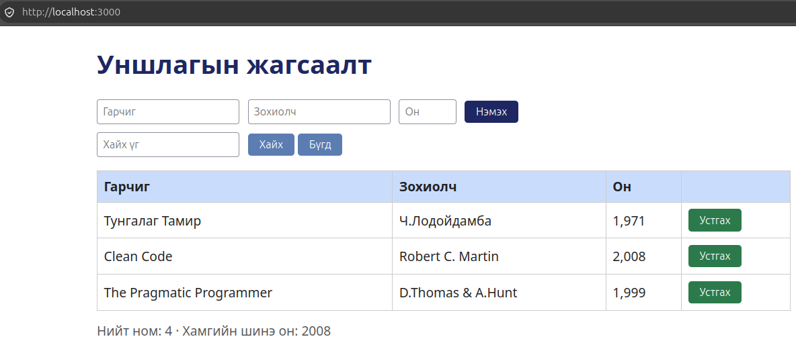

# BUG-06: Устгах үйлдлийн товч шаардсан улаан өнгийн оронд ногоон харагддаг

- **Орчин:** «Уншлагын жагсаалт» v2.0, Ubuntu Linux, session-д ашигласан браузер (яг хувилбарыг README-ийн орчны хэсгээс харна).
- **Session-д олдсон цаг:** 2026-10-17 00:11:01, UTC+08:00.
- **Олдсон аялал:** Supermodel.

## Урьдчилсан нөхцөл

Өмнөх Node процессыг Ctrl+C-ээр зогсоож `node app.js`-ийг шинээр ажиллуулсан. Браузерын хуудсыг refresh хийсэн, анхны гурван номтой төлөвөөс эхэлнэ. Өөр тестийн нэмсэн ном, өөрчилсөн төлөвт найдахгүй.

## Дахин гаргах алхам

1. http://localhost:3000 хаягийг нээнэ.
2. Номын мөр бүрийн Устгах товчны өнгийг ажиглана; товч дарах шаардлагагүй.
3. Устгах товчны өнгийг спецификацийн аюултай үйлдлийн өнгийн дүрэмтэй харьцуулна.

## Хүлээгдэж буй үр дүн

Спецификацийн дагуу аюултай үйлдлийн Устгах товч улаан байна.

## Бодит үр дүн — session-ийн нотолгоо

Устгах товчнууд ногоон дэвсгэртэй харагдсан.

## Ноцтой байдал

Cosmetic — товчны өнгө тодорхойлсон загвартай нийцэхгүй; энэ тайлан устгах үйлдлийн ажиллагаа эвдэрсэн гэж дүгнээгүй.

## Нотолгоо

[Session report](../session-report.md)
