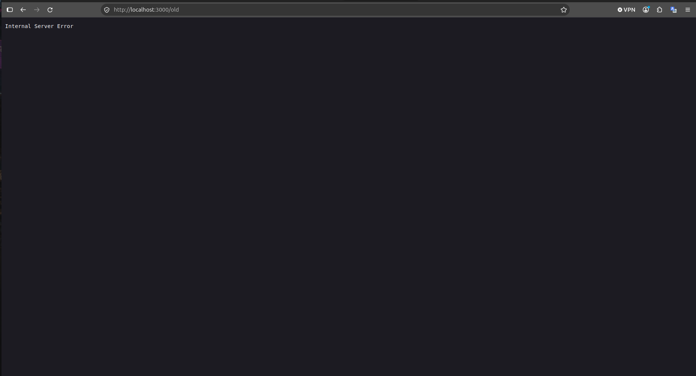

# BUG-07: Хуучин хувилбар холбоос Internal Server Error хуудас нээдэг

- **Орчин:** «Уншлагын жагсаалт» v2.0, Ubuntu Linux, session-д ашигласан браузер (яг хувилбарыг README-ийн орчны хэсгээс харна).
- **Session-д олдсон цаг:** 2026-10-17 00:13:54, UTC+08:00.
- **Олдсон аялал:** Supermodel-оос үүдсэн нэмэлт холбоосын судалгаа.

## Урьдчилсан нөхцөл

Өмнөх Node процессыг Ctrl+C-ээр зогсоож `node app.js`-ийг шинээр ажиллуулсан. Браузерын хуудсыг refresh хийсэн, анхны гурван номтой төлөвөөс эхэлнэ. Өөр тестийн нэмсэн ном, өөрчилсөн төлөвт найдахгүй.

## Дахин гаргах алхам

1. http://localhost:3000 хаягийг нээнэ.
2. Хуудасны footer хэсгийн «Хуучин хувилбар» холбоосыг дарна.
3. Шилжсэн URL болон хуудасны агуулгыг ажиглана.

## Хүлээгдэж буй үр дүн

«Бүх хуудас, линк ажиллана» гэсэн дүрмийн дагуу холбоос ажиллагаатай хуудас руу шилжинэ. Хуучин хуудасны яг хувилбар, агуулгыг спецификаци тогтоогоогүй.

## Бодит үр дүн — session-ийн нотолгоо

Браузер http://localhost:3000/old хаяг руу шилжиж, Internal Server Error гэсэн текст харуулсан. Screenshot-оос HTTP статусын тоог тогтоохгүй.

## Ноцтой байдал

Major — холбоосын зорилтот хуудсыг ашиглах боломжгүй.

## Нотолгоо

[Session report](../session-report.md)
